<picture>
  <source media="(prefers-color-scheme: dark)" srcset=".github/assets/header-dunkel.svg">
  
</picture>

Part of <b>myOS</b> by <a href="https://github.com/Wellux">Wellux</a> · public · archived · read only

> [!NOTE]
> **Archived, read only.** An early version of my Claude Code toolkit: skills, agents and an autonomous loop in one template.

### Where it went

What proved useful moved into the tools behind myOS, the personal AI operating system that launches on 1 January 2027, 5 pm CET.

[Marco on GitHub](https://github.com/Wellux) · [awesome-agent-os](https://github.com/Wellux/awesome-agent-os) · [well-ux.com](https://well-ux.com)

---

Built by <a href="https://github.com/Wellux">Marco Mengele · Wellux</a> · From leak to solution. One block at a time.

